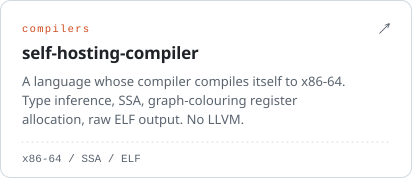
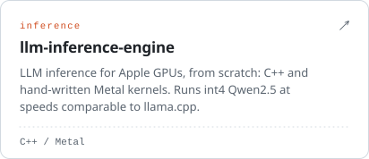
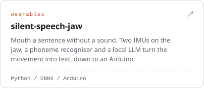
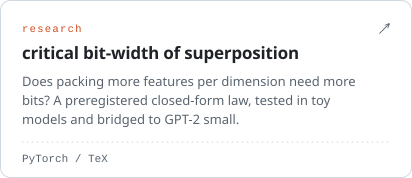
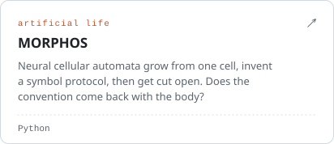
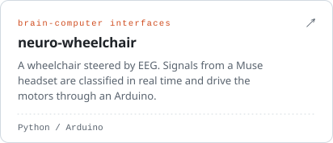

<picture><source media="(prefers-color-scheme: dark)" srcset="https://raw.githubusercontent.com/LakshyaV/LakshyaV/output/header-dark.svg"></picture>

  <a href="http://lakshyav.is-a.dev">website</a>
  &nbsp;·&nbsp;
  <a href="https://www.linkedin.com/in/lakshyav/">linkedin</a>
  &nbsp;·&nbsp;
  <a href="https://github.com/LakshyaV?tab=repositories">everything else</a>
  &nbsp;·&nbsp;
  

<picture><source media="(prefers-color-scheme: dark)" srcset="assets/rule-dark.svg"></picture>

  <a href="https://github.com/LakshyaV/self-hosting-compiler"><picture><source media="(prefers-color-scheme: dark)" srcset="assets/card-compiler-dark.svg"></picture></a>&nbsp;<a href="https://github.com/LakshyaV/llm-inference-engine"><picture><source media="(prefers-color-scheme: dark)" srcset="assets/card-inference-dark.svg"></picture></a>
   
  <a href="https://github.com/LakshyaV/silent-speech-jaw"><picture><source media="(prefers-color-scheme: dark)" srcset="assets/card-speech-dark.svg"></picture></a>&nbsp;<a href="https://github.com/LakshyaV/neurips_workshop"><picture><source media="(prefers-color-scheme: dark)" srcset="assets/card-bitwidth-dark.svg"></picture></a>
   
  <a href="https://github.com/LakshyaV/MORPHOS"><picture><source media="(prefers-color-scheme: dark)" srcset="assets/card-morphos-dark.svg"></picture></a>&nbsp;<a href="https://github.com/LakshyaV/neuro-wheelchair"><picture><source media="(prefers-color-scheme: dark)" srcset="assets/card-wheelchair-dark.svg"></picture></a>

